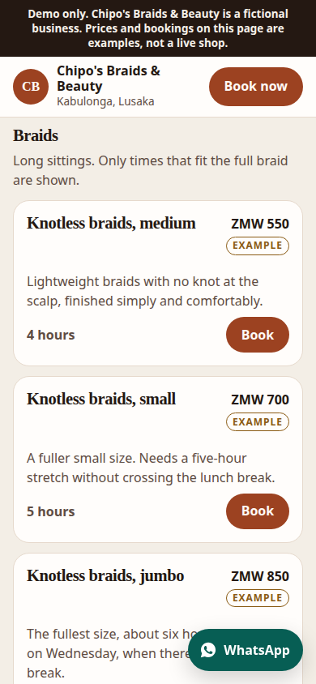
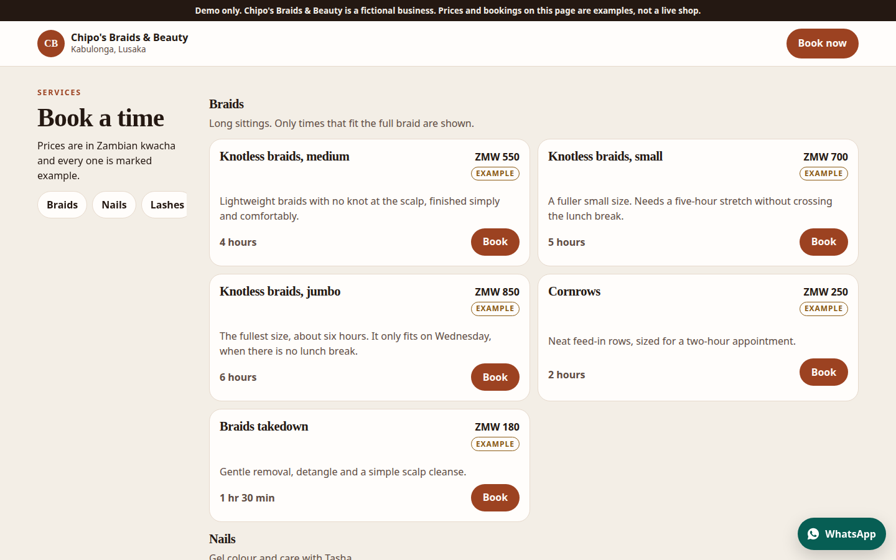
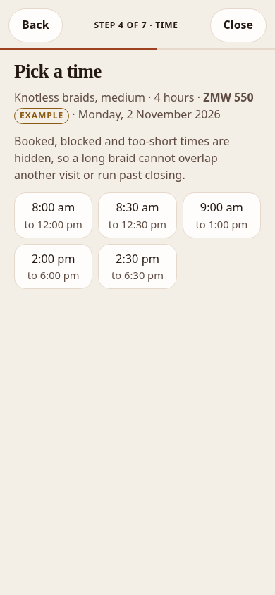
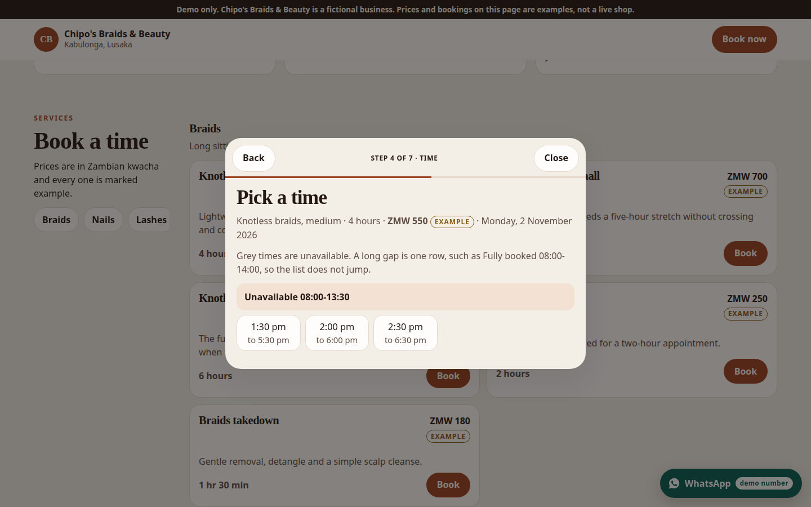
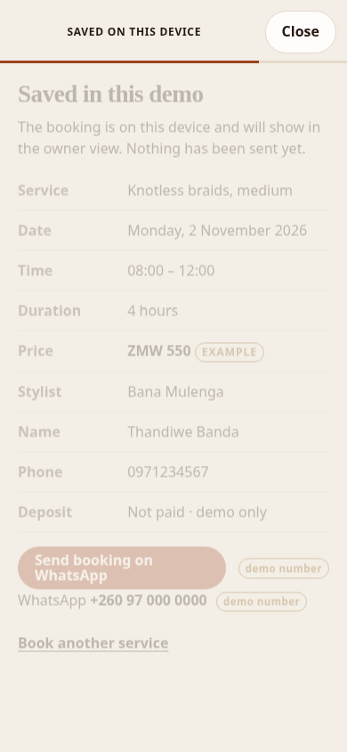
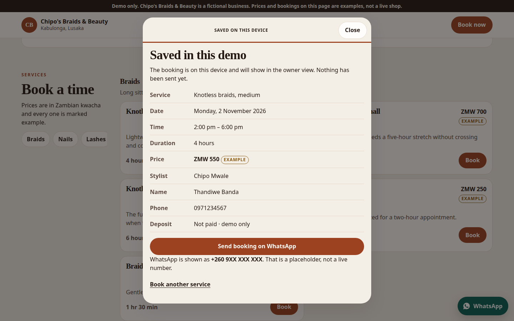
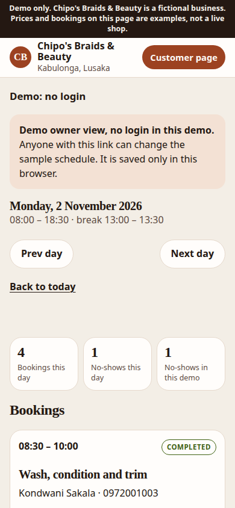
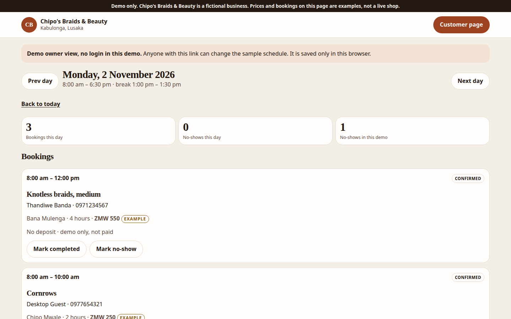

# bookit-lusaka

A mobile-first booking page for small Lusaka businesses: salons, braiders, clinics and barbers. It is a static demo. There is no account system, no server and no payment provider.

The sample brand is **Chipo's Braids & Beauty, Kabulonga**. The business, staff, prices and bookings are fictional. Every service price is labelled **example**.

## Screenshots

Services, the time picker, confirmation and the owner schedule. The phone shots are 390px wide and the desktop shots are 1440px wide.

| | Phone | Desktop |
| --- | --- | --- |
| Services |  |  |
| Time slots |  |  |
| Confirmation |  |  |
| Owner view |  |  |

## Run it

Node 20 or newer. The GitHub Pages workflow uses Node 24.

```bash
npm install
npm test
npm run dev
```

Open [http://localhost:5173/bookit-lusaka/](http://localhost:5173/bookit-lusaka/). The Vite `base` is `/bookit-lusaka/`, so the site is not served from `/`.

Other presets:

- Clinic: [http://localhost:5173/bookit-lusaka/?config=clinic](http://localhost:5173/bookit-lusaka/?config=clinic)
- Barber: [http://localhost:5173/bookit-lusaka/?config=barber](http://localhost:5173/bookit-lusaka/?config=barber)
- Owner schedule: [http://localhost:5173/bookit-lusaka/owner.html](http://localhost:5173/bookit-lusaka/owner.html)

Build and preview the production files:

```bash
npm run build
npm run preview
```

The preview is at `http://localhost:4173/bookit-lusaka/`.

## Rebrand

Each business is one JSON file in `public/config/`:

| File | Preset | Query |
| --- | --- | --- |
| `salon.json` | Chipo's Braids & Beauty, Kabulonga | default, or `?config=salon` |
| `clinic.json` | Mtendere Physio Studio, Longacres | `?config=clinic` |
| `barber.json` | Saka's Barbershop, Woodlands | `?config=barber` |

Switching is the `config` query parameter. To make another file the default, change `DEFAULT_CONFIG` in `src/config.js` (one line). A new file such as `public/config/nails.json` is picked up by `?config=nails` as long as the name is lowercase letters, numbers and hyphens.

The JSON sets the name, area, tagline, initials, address, the WhatsApp placeholder, opening hours, staff, services, deposit mock, sample policies, placeholder social handles, and gallery. Cream paper, black ink, hot pink, and the display and serif fonts are shared publication tokens in CSS. Salon, clinic, and barber presets all use that palette.

`phone.whatsappE164` is the only phone number. In every shipped preset it is `260970000000`, a **placeholder, not a real WhatsApp account**. The page formats those same digits as `+260 97 000 0000` and labels them **demo number**. The WhatsApp link uses the same digits. Replace this one value when this is no longer a demo.

Leave the demo banner in place until the business, prices and bookings are real. The pages also send `noindex` so the fictional prices are less likely to be indexed. Remove that meta tag for a real business.

Sample bookings and blocked times live in `public/data/seed.json`, keyed by the config id. They are copied into `localStorage` on first visit. The owner page has **Reset demo data**, which restores that sample.

## What a customer can do

1. Pick a service. Prices show the kwacha amount and the word example.
2. Optionally pick a staff member, or leave no preference.
3. Pick a date. Closed days are visible and cannot be selected.
4. Pick a time. Open times use 24-hour `HH:MM`. Grey times cannot be booked. A peach row is a longer booked stretch, such as `Fully booked 08:00-14:00`.
5. Enter a name and phone number, then review the booking.
6. Optionally open the Mobile Money step. It lists MTN MoMo, Airtel Money and Zamtel. It is marked **Demo**. Nothing is charged and nothing is sent to a provider. This step comes after the review.
7. Confirm on WhatsApp. The booking is saved in this browser and a `wa.me` link is built with the service, date, time, duration, example price, name and phone. The number is read from the config and labelled **demo number**.

A four-hour braid only appears when the whole sitting fits before closing, misses the lunch break, and does not overlap a booking or a block. Knotless braids, jumbo (six hours) only fit on Wednesday at the salon, because that is the day without a lunch break.

## Owner view

`owner.html` is a demo. It says **Demo: no login** and keeps the longer note, **Demo owner view, no login in this demo.** There is no password. On a phone the header is compact and scrolls away, so it does not cover the day's stats.

From a chosen day you can:

- read that day's bookings
- block time for one person or the whole shop
- remove a block
- mark a booking completed or no-show
- see how many no-shows are on that day and in the saved demo
- reset the sample data

A confirmed or completed booking holds its slot. A no-show frees it. A booking made on the customer page is stored in `localStorage` and shows up in the owner view on the same device. The slot then disappears from the customer time list.

Storage key: `bookit-lusaka:v1:<config id>`.

## Data model

Times are 24-hour `HH:MM` in `Africa/Lusaka`. Dates are `YYYY-MM-DD`. Ranges are half-open: a booking that ends at 11:00 does not block an 11:00 start.

### Service

```json
{
  "id": "knotless-medium",
  "name": "Knotless braids, medium",
  "description": "Lightweight braids with no knot at the scalp.",
  "durationMinutes": 240,
  "priceZmw": 550,
  "staffIds": ["chipo", "bana"]
}
```

`staffIds` limits who can do the service. Omit it to allow every staff member. `priceZmw` is an example amount. The interface always prints the word example next to it.

Opening hours are keyed by weekday. `null` means closed. `breaks` are times the service cannot cross.

```json
"monday": {
  "open": "08:00",
  "close": "18:30",
  "breaks": [{ "start": "13:00", "end": "13:30" }]
}
```

### Seed file

`public/data/seed.json` uses `dayOffset` from today in Lusaka, not a fixed calendar date. The offset counts **open** days: `0` is today when today is open, otherwise the next open day, and a negative offset walks backward through open days. Closed days, such as Sunday at the salon, never receive sample bookings or blocks. Each preset has exactly one `no-show`, and a block, on that next open day. When today is closed, the owner schedule and the customer date picker open on that day so the sample is visible immediately. The sample is rebuilt when the calendar day changes; bookings you added stay.

```json
{
  "bookings": [
    {
      "dayOffset": 0,
      "start": "09:00",
      "serviceId": "cornrows",
      "staffId": "chipo",
      "customerName": "Mwaka Phiri",
      "customerPhone": "0972001001",
      "status": "confirmed"
    }
  ],
  "blocked": [
    {
      "dayOffset": 0,
      "start": "15:00",
      "end": "17:30",
      "staffId": "lombe",
      "reason": "Product training"
    }
  ]
}
```

`staffId: null` on a block closes that stretch for the whole shop.

### Saved booking

Written to `localStorage` when someone confirms, or materialised from the seed. Duration and price are copied from the service at that moment.

```json
{
  "id": "bk-…",
  "date": "2026-11-02",
  "start": "08:00",
  "durationMinutes": 240,
  "priceZmw": 550,
  "serviceId": "knotless-medium",
  "serviceName": "Knotless braids, medium",
  "staffId": "bana",
  "customerName": "Thandiwe Banda",
  "customerPhone": "0971234567",
  "status": "confirmed",
  "depositDemo": null
}
```

`status` is `confirmed`, `completed` or `no-show`. `depositDemo` is a provider id if the mock deposit screen was used, otherwise `null`. It does not mean money moved.

### Blocked time

```json
{
  "id": "blk-…",
  "date": "2026-11-02",
  "start": "15:00",
  "end": "17:30",
  "staffId": "lombe",
  "reason": "Product training"
}
```

## Slot rules

`src/slots.js` builds the time list. `npm test` covers it.

A start time is offered only when all of these are true:

- the weekday is open
- the service finishes at or before closing
- the sitting does not overlap a break
- for the chosen person, or for at least one eligible person when there is no preference, the sitting does not overlap a confirmed or completed booking
- the same is true for blocked time, including whole-shop blocks
- the start is not already in the past when the date is today

No-show and cancelled bookings do not hide a slot. The time list still shows those starts that cannot be booked: one or two as grey unavailable buttons, and three or more as a single row. `getSlotTimeline` builds that list. `getAvailableSlots` is the bookable subset.

## Deploy

`.github/workflows/deploy.yml` publishes `dist` to GitHub Pages on a push to `main`. In the repository settings, set Pages to **GitHub Actions**. The public URL for this repository is `https://devdennie.github.io/bookit-lusaka/`.

## Magazine restyle

The customer landing page is laid out like a small magazine: a ruled masthead, a meet-your-stylist collage, an hours and visit grid, and sample booking policies. **Book today** jumps to the booking section, and the next tap opens the existing booking flow. The booking dialog and the owner page use the same cream paper (`#f4efe4`), black ink (`#141414`), and hot pink (`#be185d`).

Hot pink on the cream paper is about 5.3:1, and white text on the pink buttons is about 6:1, so both meet WCAG AA. Pink is not used for small text on the pink itself. Focus is a black outline set off the control. The stylist collage, hours, visit line, tag-us handles, and policies all come from the business config, so `?config=clinic` and `?config=barber` show their own words in the same layout.

## Images and fonts

The mark, hero illustrations, and the framed collage are original SVGs drawn for this demo (`public/favicon.svg`, `src/art.js`, `public/images/arc-study.svg`, `public/images/loop-study.svg`, `public/images/circle-study.svg`). There are no third-party photographs. The collage and the visit gallery lazy-load those SVGs.

Headings and buttons use [Barlow Condensed](https://fonts.google.com/specimen/Barlow+Condensed). Body text uses [Newsreader](https://fonts.google.com/specimen/Newsreader). Both are served by Google Fonts and used under the SIL Open Font License.

## Licence

MIT. See [LICENSE](LICENSE).
